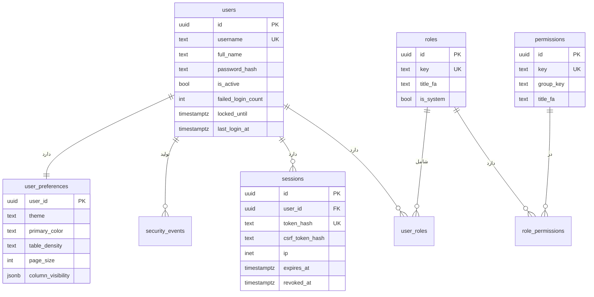
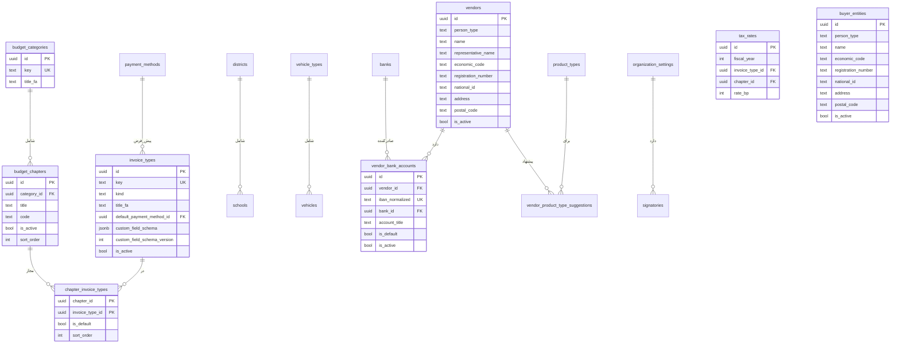
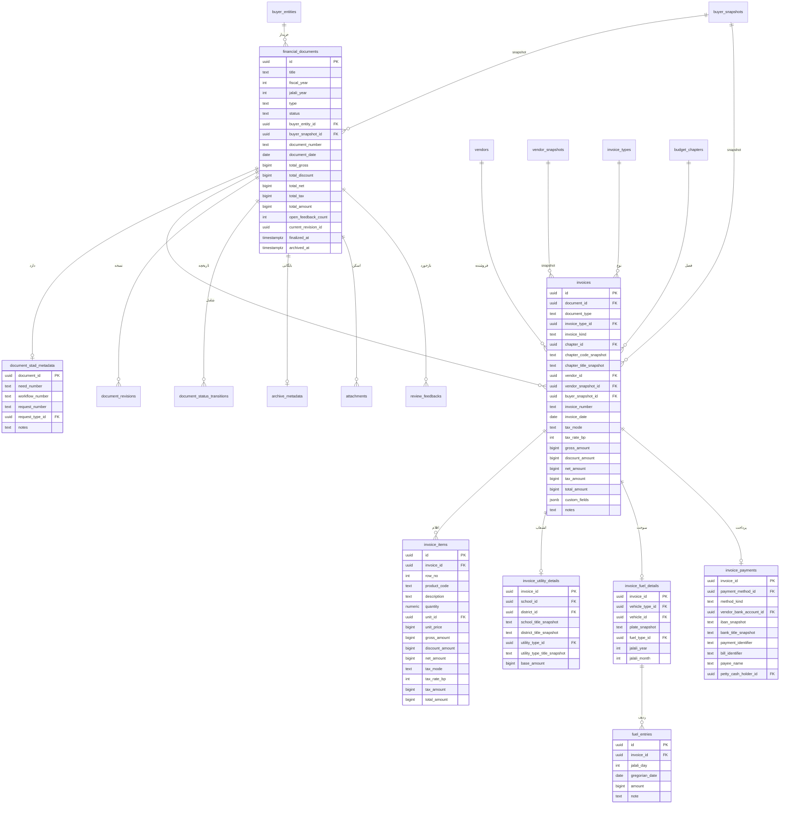
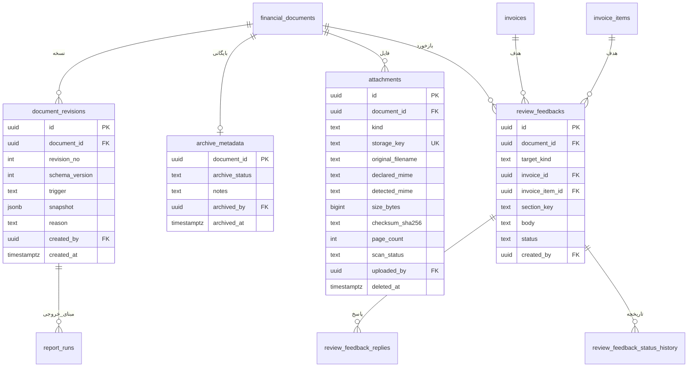
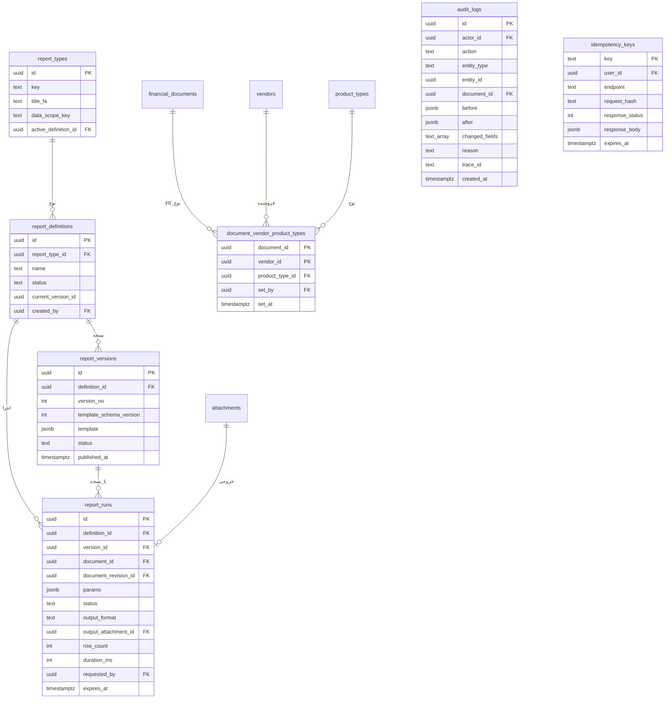

# ۰۳ — مدل داده و ERD

نام‌گذاری: جداول `snake_case` جمع، کلید اصلی `id` از نوع `uuid` (نسخه ۷ برای ترتیب زمانی)،
زمان رویدادها `timestamptz`، تاریخ‌های تقویمی `date` خالص، **تمام مبالغ `BIGINT` ریال صحیح**.

> مبالغ هرگز `NUMERIC` یا `DOUBLE` نیستند. دلیل و قرارداد انتقال در
> [ADR-0003](adr/ADR-0003-money-bigint-rial.md) و [08-financial-rules.md](08-financial-rules.md).

---

## ۱. هویت و دسترسی



نکته‌ها:

- `sessions.token_hash` هش توکن است، نه خود توکن؛ افشای دیتابیس به سرقت نشست منجر نمی‌شود.
- `security_events` رویدادهای ورود موفق/ناموفق، قفل حساب، تغییر رمز و خروج اجباری را نگه می‌دارد.
- نقش‌ها داده مرجع هستند (`is_system = true` برای کارپردازی/بایگانی/ناظر) و قابل حذف نیستند.

---

## ۲. اطلاعات پایه



سایر جداول اطلاعات پایه با همین الگو (`id`, `title`, `code?`, `is_active`, `sort_order`):
`utility_types`, `fuel_types`, `stad_request_types`, `product_types`, `measurement_units`,
`fiscal_years`, `signatories`, `banks`, `payment_methods`, `system_settings`.

قواعد مشترک اطلاعات پایه:

- **حذف نمی‌شوند**؛ `is_active = false` می‌شوند. تلاش برای حذف رکورد استفاده‌شده با خطای
  صریح و شمارش اسناد مرتبط رد می‌شود (الزام §۸.۱۰ پرامپت).
- رکورد غیرفعال در فرم **سند جدید** قابل انتخاب نیست، اما اسناد قبلی کاملاً سالم می‌مانند،
  چون مقادیر نمایشی در فاکتور snapshot شده‌اند.
- `fiscal_years` برای پر کردن فهرست سال مالی و امکان **بستن** سال استفاده می‌شود؛ ورود دستی
  سال همچنان مجاز است ولی سال بسته برای سند جدید رد می‌شود.

---

## ۳. هسته: سند، فاکتور و snapshotها



**شرح ردیف فرم ریزهزینه** در `invoice_report_titles` می‌نشیند و نه در
`invoices.description`: شرح فاکتور حقیقتِ تاریخیِ سند است و عبارتی که روی فرم چاپ
می‌شود یک تصمیم گزارش. کلیدش خودِ فاکتور است (هر ردیفِ فرم یک فاکتور) و دقیقاً یکی
از `product_type_id` یا `custom_title` را دارد — همان قاعدهٔ «نوع کالا»ی گزارش
مالیات، با کلیدی دیگر.

### ۳.۱ چرا snapshot در جدول، نه JSON

`vendor_snapshots` و `buyer_snapshots` جداول **تغییرناپذیر** با ستون‌های تایپ‌شده‌اند، نه
یک ستون JSON. دلیل: گزارش مالیات باید روی همین اطلاعات تاریخی **فیلتر، مرتب‌سازی و تجمیع**
کند؛ با JSON بی‌schema این کار به کوئری‌های شکننده و غیرقابل ایندکس تبدیل می‌شود.
([ADR-0005](adr/ADR-0005-snapshot-tables.md))

هر فاکتور **ردیف snapshot اختصاصی خودش** را دارد (به اشتراک گذاشته نمی‌شود) تا هیچ مسیری
برای بازنویسی ناخواسته اطلاعات تاریخی وجود نداشته باشد. ردیف‌های snapshot `UPDATE` نمی‌شوند؛
این قاعده با مجوز سطح دیتابیس (REVOKE UPDATE از نقش برنامه) نیز قابل تثبیت است.

مقادیر snapshot فصل، مدرسه، ناحیه، نوع انشعاب، پلاک و شبا به‌صورت ستون `*_snapshot`
کنار FK زنده نگهداری می‌شوند: FK برای گزارش‌گیری و پیشنهادها، snapshot برای نمایش تاریخی.

### ۳.۲ خریدار

خریدار در **سطح سند** انتخاب می‌شود (`financial_documents.buyer_entity_id`) و در لحظه ایجاد
سند snapshot می‌شود. هر فاکتور به **همان** `buyer_snapshot_id` اشاره می‌کند تا فاکتور
خودبسنده باشد و خروجی فاکتور بدون join به سند قابل تولید باشد. (تصمیم B13 — نیازمند تأیید)

### ۳.۳ محدودیت یک فاکتور در سند ستاد

```sql
ALTER TABLE financial_documents ADD CONSTRAINT financial_documents_id_type_uk
  UNIQUE (id, type);

ALTER TABLE invoices ADD CONSTRAINT invoices_document_fk
  FOREIGN KEY (document_id, document_type)
  REFERENCES financial_documents (id, type)
  ON UPDATE CASCADE;

CREATE UNIQUE INDEX invoices_one_per_stad_document_uk
  ON invoices (document_id) WHERE document_type = 'STAD';
```

این سه‌گانه سه چیز را **در سطح دیتابیس** تضمین می‌کند:

1. سند ستاد بیش از یک فاکتور نمی‌گیرد — حتی با دو درخواست همزمان (ریسک R7).
2. `invoices.document_type` هرگز نمی‌تواند با نوع واقعی سند ناسازگار شود.
3. تغییر نوع سند از «عادی» به «ستاد» وقتی دو فاکتور دارد، با cascade منتشر می‌شود و
   ایندکس یکتا تراکنش را **رد** می‌کند — یعنی همان رفتار مطلوب، بدون نوشتن کد نگهبان.

### ۳.۴ تغییرات ناشی از پاسخ‌های کارفرما

| تغییر | جزئیات |
|---|---|
| **فروشنده روی همه انواع فاکتور** (Q1) | `invoices.vendor_id` و `vendor_snapshot_id` برای هر چهار `kind` قابل استفاده‌اند و `nullable` می‌مانند (اختیاری). |
| **سیاست گرد کردن** (Q3) | ستون `financial_documents.rounding_policy jsonb NOT NULL` — snapshot از تنظیمات سازمان در لحظه ایجاد سند، قفل‌شده پس از ثبت نهایی. [ADR-0012](adr/ADR-0012-rounding-policy-snapshot.md) |
| **نرخ مالیات ۱۰٪** (Q4) | ردیف seed در `tax_rates` با `rate_bp = 1000`؛ بدون hardcode در کد. |
| **کارپرداز تنخواه** (Q9) | `invoice_payments.petty_cash_holder_id` به فهرست افراد/کاربران + `notes`. |

### ۳.۵ ستون‌های جمع ذخیره‌شده

`financial_documents.total_*` و `invoices.*_amount` مقادیر **محاسبه‌شده و ذخیره‌شده** هستند
(نه generated column، چون از جدول فرزند جمع می‌شوند). قاعده:

- فقط لایه `financial` آن‌ها را می‌نویسد، همیشه داخل همان تراکنشی که ردیف‌ها را تغییر می‌دهد.
- در هر ثبت نهایی، بازمحاسبه و تطبیق انجام می‌شود؛ اختلاف = خطا، نه تصحیح خودکار.
- یک کوئری تطبیق (reconciliation) در تست یکپارچه و در job سلامت دوره‌ای اجرا می‌شود:
  جمع ردیف‌ها باید با جمع ذخیره‌شده فاکتور و جمع فاکتورها با جمع سند **برابر** باشد.

---

## ۴. نسخه‌بندی سند، بایگانی، بازخورد



- **`document_revisions.snapshot`** تنها جایی است که JSON بی‌ساختار پذیرفته می‌شود، چون
  هدفش بازسازی وضعیت گذشته است نه کوئری‌پذیری. `schema_version` تضمین می‌کند خواننده آینده
  بتواند نسخه‌های قدیمی را درست تفسیر کند. ([ADR-0009](adr/ADR-0009-document-revisions.md))
- **شماره و تاریخ سند** تنها در `financial_documents` نگهداری می‌شوند (نه در
  `archive_metadata`) تا دو منبع حقیقت ایجاد نشود؛ ایندکس یکتایی و فیلترها هم همان‌جا
  طبیعی‌اند. `archive_metadata` فقط اطلاعات **فرایند** بایگانی را دارد.
- **بازخورد حذف نمی‌شود**؛ فقط وضعیتش تغییر می‌کند و هر تغییر در
  `review_feedback_status_history` ثبت می‌شود.
- `attachments.deleted_at` تنها soft-delete پروژه است و معنای عملیاتی روشن دارد: فایل از
  UI حذف شده ولی برای ردپای حسابرسی باقی می‌ماند. شیء ذخیره‌سازی طبق سیاست retention پاک می‌شود.

---

## ۵. گزارش‌گیری، حسابرسی و زیرساخت



- `report_versions.template` پس از `PUBLISHED` شدن **تغییرناپذیر** است؛ ویرایش، نسخه جدید
  می‌سازد. بنابراین خروجی تاریخی با تغییر قالب خراب نمی‌شود.
- `report_runs` هم `version_id` و هم `document_revision_id` را نگه می‌دارد؛ یعنی هر خروجی
  تاریخی **قابل بازتولید بیت‌به‌بیت** است.
- «نوع کالا» در گزارش مالیات به کلید `(document_id, vendor_id)` بسته است، نه به فروشنده
  به‌تنهایی — چون یک فروشنده در سندهای مختلف نوع کالای متفاوت دارد. پیشنهادهای اختصاصی
  همان فروشنده در `vendor_product_type_suggestions` با شمارش استفاده نگهداری می‌شوند.
- `audit_logs` فقط `changed_fields` و مقادیر لازم را نگه می‌دارد؛ فیلدهای حساس
  (هش رمز، توکن) هرگز وارد `before`/`after` نمی‌شوند.

---

## ۶. constraintهای کلیدی

| موضوع | قاعده |
|---|---|
| یکتایی سند | `UNIQUE (fiscal_year, document_number) WHERE document_number IS NOT NULL` — **تأییدشده (Q5 گزینه الف): یکتا در هر سال مالی** |
| یک فاکتور ستاد | `UNIQUE (document_id) WHERE document_type = 'STAD'` |
| شبا | `UNIQUE (iban_normalized)` سراسری؛ `UNIQUE (vendor_id) WHERE is_default` |
| شناسه فروشنده | `UNIQUE (economic_code) WHERE NOT NULL`، `UNIQUE (national_id) WHERE NOT NULL` |
| فصل | `UNIQUE (category_id, code) WHERE code IS NOT NULL` |
| پلاک خودرو | `UNIQUE (plate_normalized)` |
| ردیف فاکتور | `UNIQUE (invoice_id, row_no)` |
| نسخه سند | `UNIQUE (document_id, revision_no)` |
| نسخه قالب | `UNIQUE (definition_id, version_no)` |
| نوع فاکتور پیش‌فرض فصل | `UNIQUE (chapter_id) WHERE is_default` |
| علامت مبالغ | `CHECK (gross_amount >= 0 AND discount_amount >= 0 AND net_amount >= 0 AND tax_amount >= 0)` |
| سازگاری تخفیف | `CHECK (discount_amount <= gross_amount)` — قابل تنظیم با سیاست، پیش‌فرض فعال |
| اتحاد محاسبه ردیف | `CHECK (net_amount = gross_amount - discount_amount AND total_amount = net_amount + tax_amount)` |
| حالت مالیات | `CHECK ((tax_mode='PERCENT' AND tax_rate_bp IS NOT NULL) OR (tax_mode='AMOUNT' AND tax_rate_bp IS NULL))` |
| روز سوخت | `CHECK (jalali_day BETWEEN 1 AND 31)` + اعتبارسنجی دقیق ماه در لایه دامنه |
| ماه شمسی | `CHECK (jalali_month BETWEEN 1 AND 12)` |
| حذف آبشاری | روی داده مالی **ممنوع**؛ فقط `invoice_items`، `fuel_entries` و جداول جزئیات ۱:۱ با `ON DELETE CASCADE` از فاکتور. حذف فاکتور فقط در وضعیت پیش‌نویس مجاز است. |

## ۷. ایندکس‌ها (بر اساس کوئری‌های واقعی، نه حدس)

| کوئری | ایندکس |
|---|---|
| فهرست اسناد با فیلتر سال/وضعیت/نوع | `(fiscal_year, status, type, created_at DESC)` |
| جست‌وجوی شماره سند | `(document_number)` + ایندکس یکتای جزئی موجود |
| مرتب‌سازی فاکتورهای سند (قاعده §۹) | `(document_id, invoice_date ASC, id ASC)` |
| فاکتورهای یک فروشنده در بازه | `(vendor_id, invoice_date)` |
| تجمیع گزارش مالیات برای یک سند | `(document_id, vendor_id)` روی `invoices` |
| اقلام یک فاکتور | `(invoice_id, row_no)` |
| ردیف‌های سوخت | `(invoice_id, jalali_day, id)` |
| جست‌وجوی فروشنده (نام/شناسه) | GIN روی `to_tsvector('simple', name)` + ایندکس ساده روی شناسه‌ها |
| تاریخچه یک سند | `(document_id, created_at DESC)` روی `audit_logs` |
| کارتابل بازخورد | `(status, document_id)` و `(document_id, status)` روی `review_feedbacks` |
| صف خروجی‌ها | `(status, requested_at)` روی `report_runs` |
| پاک‌سازی خروجی منقضی | `(expires_at)` روی `report_runs` |

ایندکس‌ها در فاز مربوطه با `EXPLAIN (ANALYZE, BUFFERS)` روی داده واقع‌بینانه بررسی و
در [11-testing-plan.md](11-testing-plan.md) گزارش می‌شوند — بدون حدس زدن درباره کارایی.
