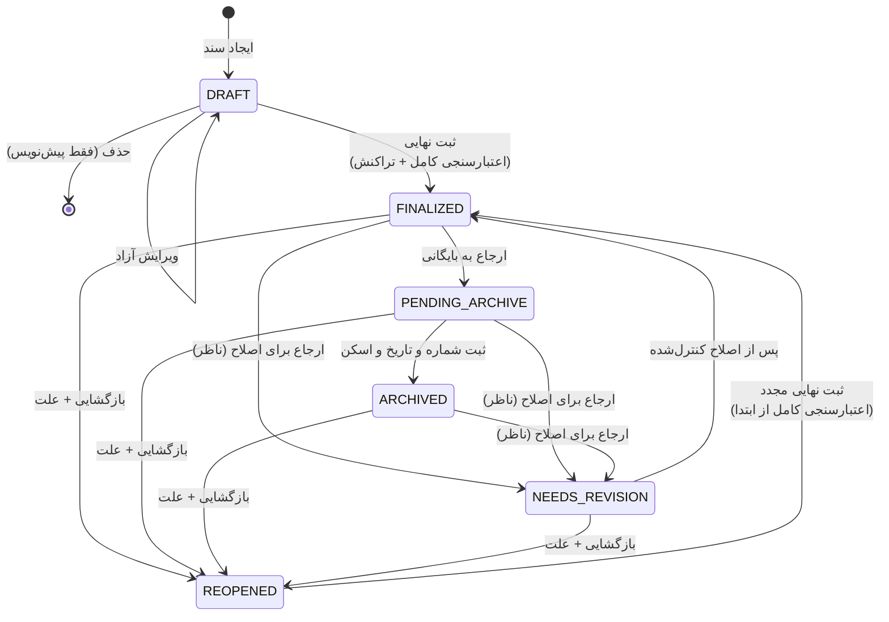
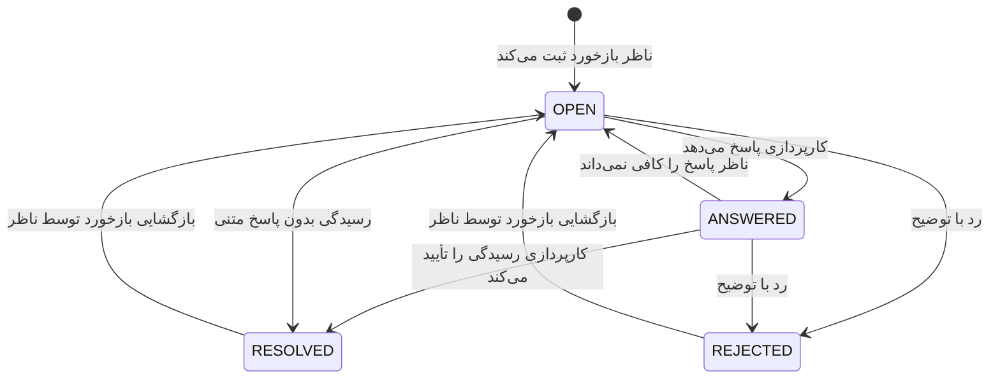

# ۰۷ — گردش کار سند

## ۱. وضعیت‌ها

| کلید | عنوان فارسی | معنا |
|---|---|---|
| `DRAFT` | پیش‌نویس | در حال ساخت؛ همه چیز قابل ویرایش |
| `FINALIZED` | ثبت‌شده | اعتبارسنجی کامل گذشته؛ مبالغ قفل |
| `PENDING_ARCHIVE` | در انتظار بایگانی | به بایگانی ارجاع شده |
| `ARCHIVED` | بایگانی‌شده | شماره، تاریخ و اسکن ثبت شده |
| `NEEDS_REVISION` | نیازمند اصلاح | ناظر سند را برای اصلاح بازگردانده |
| `REOPENED` | بازگشایی‌شده | با مجوز و علت باز شده؛ ویرایش محدود مجاز |

### چرا «دارای بازخورد» وضعیت نیست

پرامپت «دارای بازخورد یا نیازمند اصلاح» را در فهرست وضعیت‌ها آورده است. اما بازخورد روی
سند **بایگانی‌شده** هم ثبت می‌شود؛ اگر بازخورد وضعیت را تغییر دهد، سند بایگانی‌شده وضعیت
بایگانی خود را از دست می‌دهد و گردش کار بی‌معنا می‌شود.

تفکیک:

- **`open_feedback_count`** یک ستون شمارشی روی سند است که در همان تراکنش ثبت/بسته‌شدن
  بازخورد به‌روز می‌شود. در UI به‌صورت نشان (badge) «دارای بازخورد» و در فیلترها به‌صورت
  «وضعیت بازخورد» ظاهر می‌شود. ثبت یک نظر ساده، گردش کار را مختل نمی‌کند.
- **`NEEDS_REVISION`** یک وضعیت صریح است که با **اقدام آگاهانه** «ارجاع برای اصلاح» از
  سوی ناظر ایجاد می‌شود و دلیل الزامی دارد.

این تصمیم B12 است و در صورت مخالفت شما قابل تغییر.

## ۲. نمودار انتقال



انتقال‌هایی که **عمداً وجود ندارند**: `ARCHIVED → DRAFT`، `FINALIZED → DRAFT`،
هر مسیری که از `ARCHIVED` مستقیم به ویرایش مالی برسد بدون عبور از `REOPENED`.

## ۳. جدول قواعد انتقال

این جدول **داده** است، نه نثر: در `packages/shared/src/enums/document-workflow.ts` به‌صورت
یک `const` تایپ‌شده تعریف می‌شود و هم سرور (اجبار) و هم UI (نمایش اقدامات مجاز) و هم
تست‌ها از همان یک منبع می‌خوانند.

| انتقال | مجوز | نقش عملی | دلیل الزامی | فیلدهای قابل تغییر در مقصد | نسخه سند | audit | اعلان |
|---|---|---|---|---|---|---|---|
| `—→DRAFT` | `document:create` | کارپردازی | ❌ | همه | ❌ | ✅ | ❌ |
| `DRAFT→FINALIZED` | `document:finalize` | کارپردازی | ❌ | هیچ فیلد مالی | ✅ `FINALIZE` | ✅ | ✅ به ناظر |
| `FINALIZED→PENDING_ARCHIVE` | `document:send_to_archive` | کارپردازی | ❌ | هیچ | ❌ | ✅ | ✅ به بایگانی |
| `PENDING_ARCHIVE→ARCHIVED` | `archive:write` | بایگانی | ❌ | شماره سند، تاریخ سند، توضیح بایگانی، فایل‌ها | ✅ `ARCHIVE` | ✅ | ✅ به کارپردازی |
| `*→NEEDS_REVISION` | `feedback:create` + `document:read` | ناظر | ✅ | هیچ (تا بازگشایی) | ❌ | ✅ | ✅ به کارپردازی |
| `*→REOPENED` | `document:reopen` | کارپردازی | ✅ **علت** | طبق جدول بخش ۵ | ✅ `REOPEN` | ✅ | ✅ به ناظر و بایگانی |
| `REOPENED→FINALIZED` | `document:finalize` | کارپردازی | ❌ | هیچ | ✅ `FINALIZE` | ✅ | ✅ به ناظر |
| اصلاح کنترل‌شده (بدون تغییر وضعیت) | `document:correct` | کارپردازی | ✅ **دلیل** | طبق جدول بخش ۵ | ✅ `CORRECTION` | ✅ | ✅ در صورت تغییر مبلغ |

## ۴. ثبت نهایی — شرایط پذیرش

ثبت نهایی **تراکنشی** است و همه بررسی‌های زیر داخل همان تراکنش انجام می‌شوند:

1. سند حداقل یک فاکتور دارد.
2. فیلدهای الزامی سند کامل‌اند: شرح، سال مالی (و سال باز باشد)، سال شمسی، نوع سند، خریدار.
3. اگر نوع سند `STAD` است: فراداده ستاد کامل و **دقیقاً یک** فاکتور وجود دارد.
4. هر فاکتور با `detailsSchema` نوع خودش معتبر است.
5. هر فاکتور `invoice_date` دارد.
6. هر فاکتور روش پرداخت دارد و فیلدهای الزامی آن روش کامل‌اند (مثلاً شبا انتخاب شده، یا
   شناسه قبض ثبت شده اگر تنظیمات آن را الزامی کرده).
7. اگر شبا انتخاب شده: معتبر، فعال و متعلق به همان فروشنده است.
8. اقلام فاکتور ناقص وجود ندارد (شرح خالی، تعداد صفر یا منفی، مبلغ واحد منفی).
9. فاکتور چندردیفی حداقل یک ردیف دارد؛ فاکتور سوخت حداقل یک ردیف سوخت‌گیری دارد.
10. **بازمحاسبه کامل مالی** و تطبیق با مقادیر ذخیره‌شده. اختلاف ← خطای `FINANCIAL_MISMATCH`
    با مسیر دقیق فیلد. مقدار ذخیره‌شده **تصحیح خودکار نمی‌شود** چون اختلاف نشانه اشکال است.
11. snapshotها موجودند (فروشنده در صورت وجود، خریدار، فصل).

خطاها **همه با هم** برگردانده می‌شوند (نه اولین خطا)، تا کاربر یک‌بار همه مشکلات را ببیند.

### ضد ثبت تکراری

- هدر `Idempotency-Key` اجباری برای `finalize`، `reopen`، `archive` و آپلود فایل.
- `idempotency_keys` پاسخ اولین اجرای موفق را نگه می‌دارد؛ تکرار همان کلید، همان پاسخ را
  بدون اجرای دوباره برمی‌گرداند.
- `SELECT … FOR UPDATE` روی ردیف سند، پس دو درخواست همزمان سریالایز می‌شوند و دومی با
  «وضعیت فعلی اجازه این انتقال را نمی‌دهد» رد می‌شود.
- در UI دکمه پس از کلیک غیرفعال می‌شود — لایه آخر، نه لایه اول.

### پیشنهاد چاپ پس از ثبت

پس از موفقیت، پاسخ API یک پرچم `suggestedReport` برمی‌گرداند که UI آن را به‌صورت یک
دیالوگ غیرمزاحم نمایش می‌دهد:

> «سند با موفقیت ثبت شد. آیا مایل به مشاهده و چاپ خروجی مالیات هستید؟»
> [مشاهده و چاپ خروجی مالیات] [فعلاً نه]

این پرچم **مشروط** است و از تنظیمات نوع سند خوانده می‌شود، نه ثابت در کد (الزام §۱۸).
در هر زمان دیگری هم همان خروجی از صفحه جزئیات سند قابل تولید است.

## ۵. اصلاح سند نهایی — دو مسیر

### مسیر اول: اصلاح کنترل‌شده (`document:correct`)

بدون تغییر وضعیت، فقط فیلدهای فهرست سفید زیر، با **دلیل الزامی**:

| گروه | فیلدهای قابل اصلاح |
|---|---|
| سند | شرح سند |
| ستاد | شماره نیاز، شماره گردش، شماره درخواست، نوع درخواست، توضیحات |
| فاکتور | توضیحات، شماره صورتحساب |
| پرداخت | شناسه پرداخت، شناسه قبض، شبا انتخابی |
| بایگانی | توضیحات بایگانی |
| گزارش | نوع کالای ردیف گزارش مالیات |

فیلدهایی که **هرگز** با این مسیر قابل تغییر نیستند: هر مبلغ، تعداد، مبلغ واحد، تخفیف،
نرخ یا مبلغ مالیات، تاریخ صورتحساب، فروشنده، خریدار، فصل، نوع فاکتور، نوع سند،
شماره سند و تاریخ سند. این‌ها فقط از مسیر بازگشایی.

هر اصلاح: `audit_logs` با `before`/`after`/`changed_fields`/`reason` + یک
`document_revisions` با `trigger = 'CORRECTION'`.

### مسیر دوم: بازگشایی (`document:reopen`)

1. کاربر بازگشایی را با **علت الزامی** درخواست می‌کند.
2. نسخه فعلی سند پیش از هر تغییری در `document_revisions` با `trigger = 'REOPEN'` ثبت می‌شود
   — یعنی وضعیت پیش از اصلاح همیشه قابل بازیابی است.
3. وضعیت به `REOPENED` می‌رود. ویرایش **کامل** مالی مجاز می‌شود.
4. اگر سند `ARCHIVED` بود: شماره، تاریخ و فایل‌های بایگانی حفظ می‌شوند (در نسخه) و سند
   پس از ثبت نهایی مجدد باید دوباره چرخه بایگانی را طی کند. **(تأییدشده — Q7 گزینه الف)**
5. ثبت نهایی مجدد **تمام** اعتبارسنجی‌های بخش ۴ را از ابتدا اجرا می‌کند.
6. `report_runs` قبلی پاک نمی‌شوند؛ هر کدام به `document_revision_id` خودشان بسته‌اند، پس
   خروجی‌های تاریخی معنادار و قابل بازتولید می‌مانند.

### چرا نسخه کامل، نه فقط log متنی

پرامپت صریحاً می‌گوید «صرفاً ثبت یک log متنی بدون حفظ اطلاعات لازم برای بازسازی وضعیت
قبلی کافی نیست». بنابراین:

- `audit_logs` برای پاسخ به **«چه کسی چه چیزی را کِی عوض کرد»**.
- `document_revisions` برای پاسخ به **«سند در آن لحظه دقیقاً چه بود»** — snapshot کامل
  JSON شامل سند، فراداده ستاد، فاکتورها، اقلام، ردیف‌های سوخت، پرداخت‌ها و snapshotها.

جزئیات: [ADR-0009](adr/ADR-0009-document-revisions.md).

## ۶. گردش کار بایگانی

```
سند FINALIZED
   └─ کارپردازی: «ارجاع به بایگانی» → PENDING_ARCHIVE
        └─ کارتابل بایگانی (archive:read)
             ├─ ثبت شماره سند  (یکتا در هر **سال مالی** — Q5 گزینه الف)
             ├─ ثبت تاریخ سند  (تاریخ شمسی → date)
             ├─ بارگذاری اسکن‌ها (چندفایلی، با اعتبارسنجی امنیتی)
             ├─ بررسی و پیش‌نمایش فایل‌ها
             └─ «نهایی کردن بایگانی» → ARCHIVED
                  └─ نسخه ARCHIVE + اعلان به کارپردازی
```

بایگانی **هیچ** فیلد مالی را نمی‌تواند تغییر دهد — نه در UI و نه از طریق API
(جدول مجوزها + فهرست سفید فیلد در لایه سرویس).

## ۷. وضعیت بازخورد



بازخورد **حذف نمی‌شود**. هر تغییر وضعیت در `review_feedback_status_history` با نویسنده و
زمان ثبت می‌شود. `open_feedback_count` سند در همان تراکنش به‌روز می‌شود.

### چه کسی کدام گذار را انجام می‌دهد

گذارهای بالا **دو مالک متفاوت** دارند و این تقسیم، قلب اثرگذاری نظارت است:

| گذار | مجوز | نقش |
|---|---|---|
| `→ RESOLVED` و `→ REJECTED` (بستن) | `feedback:resolve` | کارپردازی |
| `→ OPEN` از هر وضعیت بسته (بازگشایی) | `feedback:reopen` | ناظر |

چرا جدا: `open_feedback_count` دروازه نهایی شدن بایگانی است. اگر بستنِ بازخورد تنها در
دست کارپردازی بود، همان کسی که ایراد به کار او گرفته شده، می‌توانست ایراد را ببندد و
سند را بایگانی کند. حالا ناظر همیشه می‌تواند بازگشایی کند و دروازه دوباره بسته می‌شود.
هیچ نقشی هر دو مجوز را ندارد و تست `feedback-transitions.test.ts` همین را تضمین می‌کند.

> این نقص در **آزمون زنده فاز ۵** پیدا شد: دو گذارِ «بازگشایی توسط ناظر» که همین سند
> وعده‌شان را داده بود، برای هیچ نقشی شدنی نبودند.
